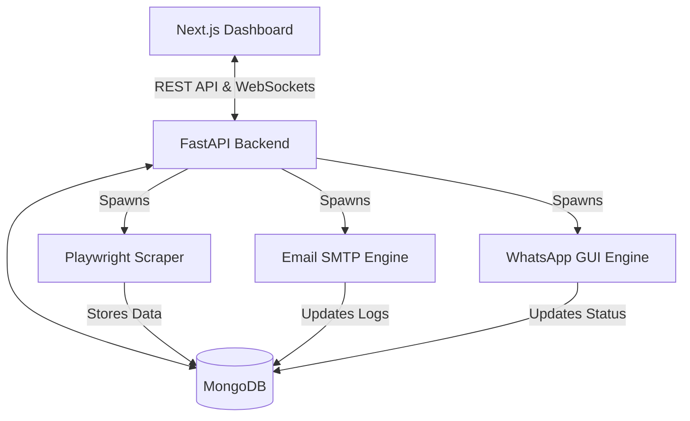

<div align="center">
  <h1>🚀 Lead Finder Agent & Enterprise Automation Platform</h1>
  <p><strong>A production-grade AI-powered lead generation, CRM, and omnichannel automation system.</strong></p>
  
  <p>
    
    
    
    
    
    
  </p>
</div>

---

## 📖 Overview

The **Lead Finder Agent** is an advanced, enterprise-ready SaaS platform built to automate the end-to-end B2B sales pipeline. It solves the critical bottleneck of manual lead generation by autonomously scraping Google Maps, navigating company websites, extracting contact information, and analyzing business data using AI. 

Once leads are captured, the platform offers a powerful built-in CRM and executes omnichannel marketing via **Real-Time WhatsApp Automation** and **Smart SMTP Email Automation**. The entire system is orchestrated by a robust Python FastAPI backend relying on a background Queue worker architecture, ensuring it can handle massive enterprise campaigns without downtime.

**Primary Use Cases:**
- B2B Lead Generation (Local businesses, specific niches)
- AI-driven Website & SEO Auditing
- Automated WhatsApp Outreach Campaigns
- High-Volume SMTP Email Campaigns with Auto-Failover
- Centralized CRM & Analytics

---

## ✨ Features

- **Google Maps Scraper**: Playwright-driven autonomous scraping to extract businesses across global regions.
- **Website Analysis Engine**: Crawls discovered websites to evaluate SEO, UI/UX, Performance, and Security.
- **AI Business Intelligence**: Automatically scores leads based on perceived business opportunities.
- **Contact & Email Discovery**: Deep web scraping to extract hidden email addresses and phone numbers.
- **Enterprise Email AI Automation**:
  - Live WebSocket-driven Campaign Dashboards
  - Smart SMTP Failover & Rotation
  - Human-like Jitter Rate Limiting
  - Bounce & Unsubscribe Blocklists
  - HTML Template Variable Injection
- **WhatsApp AI Automation**:
  - Desktop-integrated `pyautogui` WhatsApp Web automation
  - Template messaging & queue persistence
- **Centralized CRM**: Manage, tag, and export (CSV/Excel) thousands of leads.
- **Authentication**: JWT-based secure user authentication and RBAC.
- **Queue Management**: Sequential background processing with Auto-Recovery and 3x Retry policies.

---

## 🛠 Technology Stack

### Frontend
- **Framework**: [Next.js 16](https://nextjs.org/) (React 19)
- **Styling**: Tailwind CSS v4, Framer Motion, Lucide Icons
- **State Management**: Zustand, TanStack React Query v5
- **Forms**: React Hook Form, Zod validation
- **Data Visualization**: Recharts

### Backend
- **Framework**: [FastAPI](https://fastapi.tiangolo.com/) (Python)
- **Database**: MongoDB (via `motor` asynchronous driver)
- **Authentication**: JWT (`PyJWT`), `passlib[bcrypt]`
- **Web Automation**: Playwright, BeautifulSoup4
- **Desktop Automation**: PyAutoGUI, Pyperclip (For WhatsApp worker)
- **Background Jobs**: APScheduler, `asyncio` Task Groups
- **Reporting**: Pandas, OpenPyXL, ReportLab

---

## 🏗 Project Architecture

The platform follows a decoupled client-server architecture:

1. **Frontend (Next.js)**: Acts as the visual dashboard and control center. Uses React Query to constantly fetch data and connects to FastAPI WebSockets for real-time live terminal monitoring during campaigns.
2. **Backend (FastAPI)**: Serves the RESTful API and WebSocket endpoints. Validates data using Pydantic.
3. **Database (MongoDB)**: The absolute source of truth. Stores leads, user data, campaign queues, SMTP credentials, and analytical logs.
4. **Queue Workers (`asyncio`)**: Background services run independently of the HTTP server. 
   - *Scraping Worker*: Boots up headless Playwright browsers.
   - *Email Worker*: Connects via `smtplib` and dispatches personalized emails sequentially.
   - *WhatsApp Worker*: Orchestrates PyAutoGUI to physically type messages on desktop.



---

## 📂 Folder Structure

```text
Lead Finder Agent/
├── backend/
│   ├── app/
│   │   ├── api/routes/      # FastAPI endpoint routers (auth, email_ai, whatsapp_ai, leads)
│   │   ├── core/            # Config, security, and WebSocket manager
│   │   ├── db/              # MongoDB connection logic
│   │   ├── models/          # Pydantic schemas and DB structures
│   │   └── services/        # Business logic & Workers (Scraper, SMTP Engine, WhatsApp Engine)
│   ├── main.py              # FastAPI application entry point
│   └── requirements.txt     # Python dependencies
├── frontend/
│   ├── app/                 # Next.js App Router (Pages & Layouts)
│   ├── src/
│   │   ├── components/      # Reusable React components & Domain-specific logic
│   │   ├── lib/             # Axios configs and utilities
│   │   └── store/           # Zustand state management
│   ├── package.json         # Node.js dependencies
│   └── tailwind.config.ts   # Tailwind configuration
├── README.md                # Project documentation
└── How to Run.txt           # Quickstart commands
```

---

## 🚀 Installation Guide

### Prerequisites
- Node.js (v18+)
- Python (3.10+)
- MongoDB instance (Local or Atlas)

### 1. Clone the Repository
```bash
git clone https://github.com/your-org/lead-finder-agent.git
cd "Lead Finder Agent"
```

### 2. Backend Setup
```bash
cd backend
python -m venv venv

# Windows
venv\Scripts\activate
# Linux/Mac
source venv/bin/activate

pip install -r requirements.txt
playwright install
```

### 3. Frontend Setup
```bash
cd ../frontend
npm install
```

---

## 🔐 Environment Variables

### Backend (`backend/.env`)
| Variable | Required | Default | Description | Security Notes |
|----------|----------|---------|-------------|----------------|
| `MONGODB_URL` | Yes | `mongodb://localhost:27017` | Database connection string | Keep secret |
| `JWT_SECRET_KEY` | Yes | `changeme` | Key for signing JWTs | Extremely critical |
| `OPENAI_API_KEY` | No | | For AI Lead Analysis scoring | Keep secret |

### Frontend (`frontend/.env.local`)
| Variable | Required | Default | Description |
|----------|----------|---------|-------------|
| `NEXT_PUBLIC_API_URL` | Yes | `http://localhost:8000` | Backend API URL |

---

## 🏃‍♂️ Running the Project

### Development Mode

**Terminal 1 (Backend):**
```bash
cd backend
venv\Scripts\activate
uvicorn app.main:app --reload --host 0.0.0.0 --port 8000
```

**Terminal 2 (Frontend):**
```bash
cd frontend
npm run dev
```

Visit `http://localhost:3000` in your browser.

---

## 📡 API Documentation

*(Automatically generated via FastAPI Swagger)*
When the backend is running, visit **`http://localhost:8000/docs`** for interactive OpenAPI documentation.

### Core Routes:
- `POST /api/v1/auth/login` - Authenticate and retrieve JWT
- `GET /api/v1/leads` - Paginated fetch of scraped leads
- `POST /api/v1/scraper/start` - Dispatch Playwright scraper
- `POST /api/v1/email-ai/campaigns` - Launch SMTP background worker
- `WS /api/v1/email-ai/ws/{id}` - Real-time campaign log stream

---

## 🗄 Database Models

MongoDB is utilized as a schema-less NoSQL data store, strictly enforced at the application layer by Pydantic.

- **`users`**: RBAC user accounts and hashed passwords.
- **`leads`**: Core lead objects (`business_name`, `email`, `phone`, `ai_score`, `website_metrics`).
- **`email_ai_campaigns`**: Stores target leads, current progress, execution status, and nested array of delivery logs.
- **`email_ai_smtp`**: Configurable SMTP profiles with tracking for daily/hourly rate limits.
- **`email_ai_blocklist`**: Global suppression list for Hard Bounces and Unsubscribes.

---

## 🤖 AI & Automation Systems

### 1. Google Maps Scraper (`app.services.scraper`)
Uses headless `Playwright` to navigate Google Maps. It parses DOM nodes to extract business titles, phone numbers, review scores, and website URLs. Implements intelligent scrolling and auto-retry to bypass rendering delays.

### 2. WhatsApp Automation (`app.services.whatsapp_ai`)
Unlike standard APIs, this executes *True Browser Automation* using `pyautogui` and `pyperclip`. It physically opens WhatsApp Desktop/Web, locates the search bar, pastes the phone number, attaches media, and dispatches the message. It is designed to act strictly human.

### 3. Enterprise Email Engine (`app.services.email_ai`)
A highly resilient Queue processor. 
- Automatically injects variables (e.g. `{{business_name}}`).
- Utilizes an intelligent **Rate Limiter** with Jitter (`1.5s - 4.5s` random delays).
- **Auto-Failover**: Automatically disables broken SMTP profiles and seamlessly rotates to a backup mid-campaign to prevent downtime.

---

## 📊 Monitoring & Analytics

The `/dashboard/email-ai` route provides a **Real-Time Enterprise Analytics Dashboard**.
- **Live Terminal**: Displays streaming logs via WebSockets.
- **Recharts**: Renders 14-day trailing area charts of deliverability trends.
- **Error Center**: Aggregates MongoDB failures into pie-charts for immediate diagnostic tracking (Auth vs Timeout vs Validation errors).

---

## ☁️ Deployment (Production)

### Backend (Docker/Linux)
Deploy the FastAPI app using `gunicorn` with `uvicorn` workers.
```bash
gunicorn app.main:app -w 4 -k uvicorn.workers.UvicornWorker -b 0.0.0.0:8000
```

### Frontend (Vercel/Netlify)
The Next.js frontend is fully optimized for static builds or edge deployment.
```bash
npm run build
```

---

## ⚠️ Known Issues & Limitations
- **WhatsApp Desktop Focus**: The `pyautogui` WhatsApp worker requires physical control of the host machine's mouse and keyboard. The server must have an active GUI session and cannot be minimized during dispatch.
- **Playwright Captchas**: Highly aggressive scraping on Google Maps without proxies may eventually trigger CAPTCHA blocks.

---

## 🗺 Roadmap
- **Short Term**: Integrate generic proxy rotation into the Playwright scraper.
- **Mid Term**: Build a comprehensive "Sequence" builder (Email Day 1 -> WhatsApp Day 3).
- **Long Term**: Migrate WhatsApp automation from `pyautogui` to the official WhatsApp Cloud API for headless background dispatch.

---

## 🤝 Contributing
1. Create a Feature Branch (`git checkout -b feature/AmazingFeature`)
2. Commit your changes (`git commit -m 'Add some AmazingFeature'`)
3. Push to the Branch (`git push origin feature/AmazingFeature`)
4. Open a Pull Request

**Coding Standards**: Follow `PEP 8` for Python. Use `eslint` strict mode for Next.js.

---

## 📄 License
This project is proprietary and confidential. Unauthorized copying of this file, via any medium, is strictly prohibited. 
*(If Open Source, substitute with MIT License).*

---
<div align="center">
  <p>Built with ❤️ for Enterprise Sales Teams.</p>
</div>
