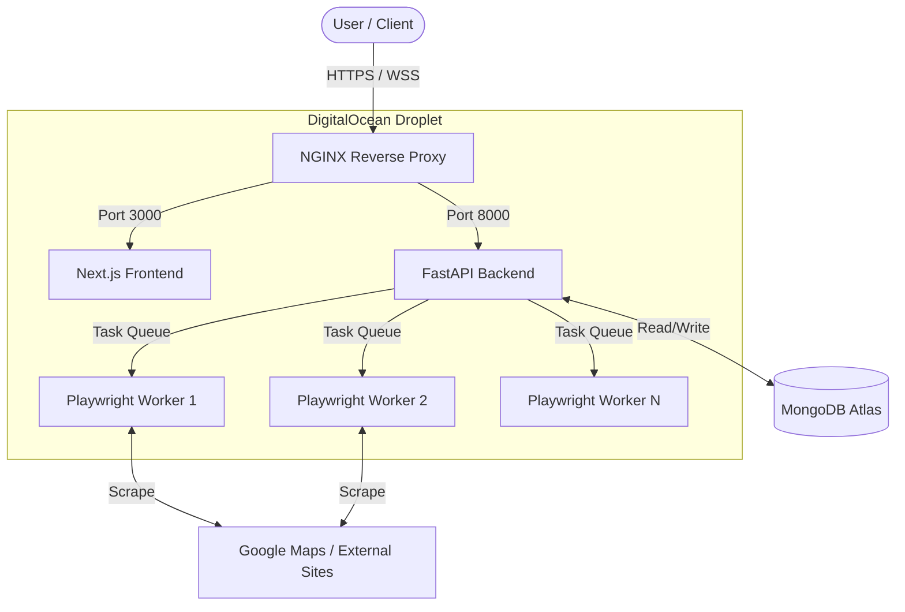

# LeadFinderAgent: Comprehensive System Information & Deployment Guide

> [!NOTE]
> This document provides an in-depth overview of the LeadFinderAgent architecture, performance expectations, IP blocking risks, and a complete, production-grade deployment guide for DigitalOcean. 

---

## 1. Project Overview

### Scraping Architecture
LeadFinderAgent is designed as an asynchronous, distributed scraping system. It separates the API layer from the heavy-lifting browser automation layer to ensure resilience and high throughput. 

### Technology Stack
* **Backend Framework:** FastAPI (Python) for high-performance, asynchronous REST APIs.
* **Database:** MongoDB for schema-less, document-oriented data storage (ideal for unstructured scraped data).
* **Browser Automation:** Playwright for controlling headless Chromium instances.
* **Task Queuing:** Internal asyncio queues and state machine architecture to manage concurrency and search lifecycles.
* **Frontend:** Next.js (React) providing the dashboard and user interface.

### How Google Maps Scraping Works
1. **Search Initialization:** The system builds a targeted Google Maps search URL based on the user's query and location.
2. **Dynamic Scrolling:** Playwright loads the page and algorithmically scrolls the results pane. Google Maps dynamically loads results via AJAX; the worker waits for network idle states and specific DOM elements to ensure results are fully rendered.
3. **Data Extraction:** The worker extracts basic information (Name, Rating, Reviews, Category, Phone, Website) from the listing cards.
4. **Deep Scraping (Optional):** If configured, the worker navigates to the extracted website to scrape additional details (e.g., social media links, emails).

### Worker Architecture & Queue System
The backend utilizes an asynchronous worker pool. When a search is initiated, it is placed into a task queue. Workers pull from this queue, execute the Playwright scripts, and stream progress updates back to the client via WebSockets. This decoupling ensures the FastAPI server remains responsive even during heavy scraping loads.

### Search Lifecycle
1. **Queued:** Request received and validated.
2. **Initializing:** Browser contexts and pages are launched.
3. **Scraping (Maps):** Scrolling and extracting primary listings.
4. **Scraping (Websites):** Visiting individual business websites for deep data.
5. **Finalizing:** Data is formatted, deduplicated, and stored in MongoDB.
6. **Completed:** Client notified via WebSocket; reports (Excel, PDF) become available.

---

## 2. How Many Leads Can Be Scraped Per Day?

Estimating scraping throughput is complex and highly dependent on network latency, Google's dynamic rate limiting, and hardware. 

> [!IMPORTANT]
> The numbers below are practical estimates based on polite scraping configurations (including human-like delays). They are *not* theoretical maximums, which would result in immediate IP bans.

### Factors Affecting Throughput
* **CPU & RAM:** Playwright browsers are resource-intensive. Insufficient RAM causes browser crashes; insufficient CPU causes timeouts.
* **Network Speed:** Faster bandwidth reduces page load times.
* **Google Maps Speed:** Google dynamically throttles response times if it detects heavy traffic.
* **Website Loading:** Scraping individual business websites (which vary wildly in performance) slows down the overall pipeline significantly.
* **Human-like Delays:** Enforced pauses (2-5 seconds between scrolls/clicks) drastically reduce throughput but are mandatory for survival.

### Throughput Estimates Table

| VPS Tier | Hardware | Max Concurrent Workers | Businesses / Hour | Businesses / Day | Best Use Case |
| :--- | :--- | :--- | :--- | :--- | :--- |
| **Small VPS** | 2 vCPUs, 2GB RAM | 1 | ~300 - 500 | ~7,200 - 12,000 | Light development, testing |
| **Medium VPS** | 4 vCPUs, 4GB RAM | 2 - 3 | ~1,000 - 1,500 | ~24,000 - 36,000 | Small scale production |
| **Large VPS** | 8 vCPUs, 16GB RAM | 6 - 8 | ~3,000 - 4,000 | ~72,000 - 96,000 | Medium scale production |
| **Enterprise VPS** | 16+ vCPUs, 32GB+ RAM| 15+ | ~7,000+ | ~150,000+ | Heavy data acquisition |

*(Estimates assume deep website scraping is enabled. If only scraping Maps listings, throughput can be 2-3x higher).*

---

## 3. Can My IP Get Blocked?

> [!WARNING]
> **YES.** IP blocking is not just possible; it is guaranteed if scraping is done aggressively without precautions.

### Google's Anti-Bot Systems
Google employs sophisticated behavioral analysis, machine learning, and IP reputation scoring to detect automated traffic. 

* **Behavior Detection:** Scrolling too fast, clicking perfectly in the center of elements, or missing standard mouse movements triggers flags.
* **Browser Fingerprinting:** Google checks canvas hashes, WebGL, fonts, and navigator properties. Default headless Playwright is easily detectable.
* **Data Center IP Reputation:** IPs from providers like DigitalOcean, AWS, and GCP are known to be data centers. Traffic originating from them is treated with high suspicion immediately.

### Types of Blocks
1. **Rate Limiting (429 Too Many Requests):** Temporary throttling. The server asks you to back off.
2. **CAPTCHA Challenges:** The browser is redirected to a CAPTCHA page. Without human intervention or a solving service, the scrape halts.
3. **Temporary IP Blocks:** Access is denied for 12-48 hours.
4. **Permanent IP Bans:** The IP is blacklisted indefinitely.

---

## 4. Best Practices to Prevent IP Blocking

To build a resilient crawler, focus on polite behavior and mimicking human interaction. Do not attempt to bypass security systems maliciously; instead, reduce load and distribute requests.

### Professional Techniques
* **Human-like Interaction:** Implement random delays (e.g., `await asyncio.sleep(random.uniform(1.5, 4.2))`), simulate mouse movements, and use viewport randomization.
* **Browser Context Isolation:** Use unique Playwright `BrowserContext` instances for different searches to clear cookies and prevent session linking.
* **Limited Concurrency:** Do not spawn 50 browsers simultaneously from a single IP. Limit workers based on hardware and IP trust.
* **Adaptive Throttling:** Monitor response times. If Google takes longer to load results, increase your delays dynamically.
* **Retry Backoff & Exponential Delays:** If a 429 is encountered, wait (e.g., 5s, 10s, 20s) before retrying.
* **Proxy Rotation:** (Highly Recommended for Production). Route traffic through rotating residential proxies to distribute the IP footprint.

---

## 5. DigitalOcean VPS Deployment Guide

### Step 1: Create DigitalOcean Account
Sign up at [DigitalOcean](https://digitalocean.com) and set up billing.

### Step 2: Create Ubuntu Droplet
* **Image:** Ubuntu 24.04 LTS
* **Size:** Recommended minimum 4GB RAM (e.g., $24/mo Basic Droplet) to prevent Playwright Out-Of-Memory (OOM) errors.
* **Region:** Closest to your target scraping geography if possible.
* **Auth:** SSH Keys (highly recommended over passwords).

### Step 3: SSH into VPS
```bash
ssh root@your_droplet_ip
```

### Step 4: Update Linux
```bash
apt update && apt upgrade -y
```

### Step 5: Install System Dependencies
Install Python, Node.js, Git, and libraries required by Chromium/Playwright.
```bash
# Core tools
apt install -y curl git python3-pip python3-venv nginx ufw certbot python3-certbot-nginx

# Playwright/Chromium dependencies & xvfb for headless displays
apt install -y xvfb libgbm1 libnss3 libxss1 libasound2 libatk-bridge2.0-0 libgtk-3-0

# Node.js (for frontend & PM2)
curl -fsSL https://deb.nodesource.com/setup_20.x | bash -
apt install -y nodejs
npm install -g pm2
```
> [!TIP]
> For MongoDB, it is highly recommended to use **MongoDB Atlas** (cloud-hosted) rather than installing it locally to save VPS RAM for Playwright. 

### Step 6: Clone GitHub Repository
```bash
git clone https://github.com/your-org/Lead-Finder-AI-Agent.git
cd Lead-Finder-AI-Agent
```

### Step 7: Configure Environment Variables
Create `.env` files in both the frontend and backend directories.
```bash
cp backend/.env.example backend/.env
cp frontend/.env.example frontend/.env
nano backend/.env
```
*(Configure `MONGODB_URL`, `JWT_SECRET`, etc.)*

### Step 8: Install Python Dependencies
```bash
cd backend
python3 -m venv venv
source venv/bin/activate
pip install -r requirements.txt
```

### Step 9: Install Node Dependencies (Frontend)
```bash
cd ../frontend
npm install
npm run build
```

### Step 10: Install Playwright Browsers
```bash
cd ../backend
playwright install chromium
playwright install-deps
```

### Step 11 & 12: Configure PM2 for Backend and Frontend
Using PM2 ensures your apps restart on failure or server reboot. We use `xvfb-run` for the backend to emulate a display for GUI automation libraries.

```bash
# Start Backend
pm2 start "xvfb-run -a /root/Lead-Finder-AI-Agent/backend/venv/bin/uvicorn app.main:app --host 127.0.0.1 --port 8000" --name "leadfinder-backend"

# Start Frontend
cd ../frontend
pm2 start npm --name "leadfinder-frontend" -- run start

# Save PM2 state
pm2 save
pm2 startup
```

### Step 13: Configure Reverse Proxy (NGINX)
```bash
nano /etc/nginx/sites-available/leadfinder
```
```nginx
server {
    listen 80;
    server_name your_domain.com;

    # Frontend
    location / {
        proxy_pass http://localhost:3000;
        proxy_set_header Host $host;
        proxy_set_header X-Real-IP $remote_addr;
    }

    # Backend API & WebSockets
    location /api/ {
        proxy_pass http://localhost:8000/;
        proxy_http_version 1.1;
        proxy_set_header Upgrade $http_upgrade;
        proxy_set_header Connection "upgrade";
        proxy_set_header Host $host;
    }
}
```
```bash
ln -s /etc/nginx/sites-available/leadfinder /etc/nginx/sites-enabled/
nginx -t
systemctl restart nginx
```

### Step 14: HTTPS using Let's Encrypt
```bash
certbot --nginx -d your_domain.com
```

### Step 15: Firewall Configuration (UFW)
```bash
ufw allow 'Nginx Full'
ufw allow OpenSSH
ufw enable
```

### Step 16: Verify Deployment
Navigate to `https://your_domain.com` in your browser. Ensure the dashboard loads and WebSocket connections (for search progress) succeed.

---

## 6. DigitalOcean Architecture



---

## 7. System Requirements

| Environment | CPU | RAM | Disk | Bandwidth | Expected Performance |
| :--- | :--- | :--- | :--- | :--- | :--- |
| **Development** | 2 vCPUs | 2GB | 25GB SSD | 1 TB | Single search stream; prone to OOM if pushed. |
| **Testing** | 2 vCPUs | 4GB | 50GB SSD | 2 TB | Stable single/dual search streams. |
| **Production** | 4-8 vCPUs | 8-16GB | 100GB NVMe| 4 TB | Handles 4-8 concurrent searches smoothly. |
| **Enterprise** | 16+ vCPUs | 32GB+ | 250GB NVMe| 10 TB+ | High-volume concurrent scraping pipeline. |

---

## 8. Production Recommendations

* **Process Manager:** Always use PM2 or systemd. Never run the app in a bare `tmux` or `screen` session in production.
* **Monitoring:** Use DigitalOcean Monitoring (install the agent) to track RAM spikes. Playwright memory leaks can crash the server over time.
* **Logging:** Configure PM2 log rotation (`pm2 install pm2-logrotate`) to prevent logs from filling the disk.
* **Backups:** If using local MongoDB, configure cron jobs to dump the database to an S3 bucket daily.
* **Security:** Keep ports 8000 and 3000 closed to the outside world using UFW. Only NGINX (80/443) and SSH (22) should be exposed.

---

## 9. Troubleshooting

> [!CAUTION]
> Always check PM2 logs first when an issue arises: `pm2 logs leadfinder-backend`

| Problem | Cause | Solution |
| :--- | :--- | :--- |
| **Playwright crashes immediately** | Missing system dependencies or no virtual display. | Ensure `xvfb` is installed and the backend is started with `xvfb-run`. Run `playwright install-deps`. |
| **Browser Out of Memory (OOM)** | VPS lacks RAM or too many concurrent workers. | Upgrade VPS size. Reduce concurrency limit in backend config. Implement periodic browser restarts. |
| **Google Maps Timeout** | IP temporarily blocked or network issue. | Increase scraping delays. Rotate IP via proxies. Check if Droplet IP is blacklisted. |
| **No leads found** | DOM structure changed or CAPTCHA hit. | Check screenshots (if implemented) to see if Google presented a CAPTCHA. Update Playwright selectors if Google updated their UI. |
| **WebSocket /api/ connection fails** | NGINX not configured for WebSockets. | Ensure `Upgrade $http_upgrade;` and `Connection "upgrade";` are in the NGINX `/api/` block. |

---

## 10. FAQ

**Q: How many searches can I run simultaneously?**
A: This depends strictly on your RAM. Allow roughly 500MB to 1GB of RAM per concurrent Playwright search. 

**Q: Will Google block me?**
A: Eventually, yes, if you run continuous high-volume searches from a single Datacenter IP. Respectful delays mitigate this, but proxies are the ultimate solution.

**Q: Should I use proxies?**
A: For enterprise or heavy production use, **yes**. Rotating residential proxies are highly recommended to prevent 429 errors and CAPTCHAs.

**Q: Should I use multiple VPS servers?**
A: Horizontal scaling (multiple smaller VPSs) is often better for scraping than vertical scaling (one massive VPS) because it naturally diversifies your IP footprint, even without proxies.

**Q: Can I deploy on Windows?**
A: Yes, but it is not recommended for production. Linux (Ubuntu) uses fewer OS resources and handles headless browser automation much more efficiently.

---

## 11. Final Recommendations

For a successful, long-term enterprise deployment of LeadFinderAgent:
1. **Respect the Target:** Do not scrape aggressively. Taking 10 minutes to slowly scrape 500 leads is always better than getting blocked in 30 seconds.
2. **Resource Planning:** Monitor your RAM usage. Browsers are memory hogs. Automate worker restarts to clear memory leaks.
3. **Graceful Degradation:** Ensure your app handles 429 errors gracefully by pausing the queue, rather than crashing or continuously hammering the server.
4. **Maintenance:** Google Maps frequently updates its DOM structure. Be prepared to update your CSS/XPath selectors regularly to keep the scraper functional.
